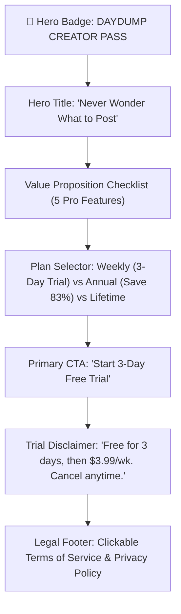

# DayDump — Brand Guidelines & Design System

**Version:** 1.0  
**Target:** iOS & Android Mobile Creator Ecosystem  
**Aesthetic Persona:** The Analog Aesthete meets On-Device Intelligence

---

## 1. Brand Essence & Narrative

### 1.1 The Vision
Every day, people capture dozens of spontaneous photos—morning coffee, sunlight through trees, dinner with friends, fleeting architecture—that get lost in a cluttered camera roll. 

**DayDump exists to turn that chaos into editorial drops.** In 5 seconds, DayDump's on-device neural vision filters the noise, identifies the standout moments, structures a cinematic 6-slide story arc, and renders ready-to-post 4:5 Instagram carousels with multi-tone captions.

### 1.2 Core Pillars
1. **Effortless Aesthetics:** Zero manual layout editing. Drop photos in; get an editorial magazine spread or vintage 35mm film reel out.
2. **Private by Design:** 100% on-device AI. Photos never touch external servers or cloud storage.
3. **Creator Velocity:** One-tap sequential export of all slides with captions automatically copied to clipboard.

---

## 2. Color Palette & Design Tokens

DayDump uses a high-contrast, moody dark theme inspired by darkroom photography and modern luxury editorial apps (Kinfolk, VSCO, Letterboxd).

### 2.1 Color Tokens

| Token Name | Hex Code | Purpose & Usage |
| :--- | :--- | :--- |
| **Obsidian Black** | `#0A0A0C` | App background, root canvas, safe areas |
| **Dark Elev 1** | `#0F0F11` | Modal backgrounds, sub-screens |
| **Card Carbon** | `#1C1C1E` | Primary cards, frame wrappers, input containers |
| **Border Slate** | `#2C2C2E` | Subtle borders, unselected tabs, inactive dots |
| **Elevated Divider** | `#3A3A3C` | Active tab backgrounds, switch tracks |
| **Sunset Amber** | `#FF9500` | Primary brand accent, 35mm date stamp, active pagination |
| **Creator Gold** | `#FFD60A` | Pro badge, Creator Pass crowns, trial highlight badges |
| **Signal Emerald** | `#30D158` | Privacy shields, active states, successful copy feedback |
| **Electric Blue** | `#0A84FF` | Manual gallery picker, external link highlights |
| **Text Primary** | `#FFFFFF` | Main titles, selected cards, active labels |
| **Text Secondary** | `#8E8E93` | Subtitles, role badges, caption text, placeholder |
| **Text Tertiary** | `#636366` | Secondary input hints, footer metadata |

---

## 3. Typography & Hierarchy

### 3.1 Font Scale & Hierarchy
* **App Wordmark:** 24pt, Font Weight `800`, Kerning `-0.5px`, White (`#FFFFFF`). Accompanied by a 18pt Sunset Amber Sparkle (`#FF9500`).
* **Hero Display (Paywall):** 24pt, Font Weight `900`, Line Height 30pt. Bold, decisive statement.
* **Section Headers:** 11pt, Font Weight `800`, Kerning `+1.0px`, All-Caps, Muted Silver (`#8E8E93`).
* **Card Titles:** 14-16pt, Font Weight `700`, Primary White.
* **Body & Captions:** 13-14pt, Font Weight `400`–`500`, Line Height 20pt. Highly legible, relaxed reading rhythm.
* **Film Stamp / Retro LED:** Monospaced 12pt, Font Weight `900`, Kerning `+1.5px`, Amber (`#FF9500`), e.g., `'26 10 16`.

---

## 4. 4:5 Instagram Carousel Geometry & Frame Styles

Instagram feeds prioritize vertical portrait content. DayDump formats every slide to standard **4:5 Aspect Ratio** (`CAROUSEL_WIDTH : Math.round(CAROUSEL_WIDTH * 1.25)`).

### 4.1 Card Dimensions & Snapping Geometry
* `CAROUSEL_WIDTH = SCREEN_WIDTH - 40`
* `CARD_GAP = 12`
* `SNAP_INTERVAL = CAROUSEL_WIDTH + CARD_GAP`
* `HORIZONTAL_PADDING = (SCREEN_WIDTH - CAROUSEL_WIDTH) / 2` (20px)

### 4.2 The 4 Aesthetic Frame Styles

1. **Clean (Free Tier):**
   - Pure borderless edge-to-edge imagery.
   - 14px rounded corners with subtle 1px border (`#2C2C2E`).
   - Includes minimalist discreet watermark: `✨ curated with DayDump`.

2. **Portra 35mm Film (Pro):**
   - Matte black frame container.
   - Top analog sprocket bar: `■ ■ ■ ■ ■ ■ ■ ■` with `PORTRA 400 • 35mm` label.
   - Lower-right Amber LED dynamic date stamp (`'YY MM DD`) based on the photo's actual timestamp.

3. **Editorial (Pro):**
   - Off-white card container (`#E5E5EA`) framing the photo like an art publication.
   - Bottom serif typography: Theme Title in all-caps + serialized plate notation (`PLATE 1 — FIG. 1`).

4. **Polaroid (Pro):**
   - High-contrast photographic card with an extended bottom chin.
   - Handwritten styling caption referencing the curated theme.

---

## 5. Paywall Architecture & Monetization Blueprint

DayDump employs an **Aggressive Creator Model** engineered to maximize trial-to-paid conversion while maintaining strict Apple App Store and Google Play compliance.

### 5.1 Paywall Structure (Visual Hierarchy)

### 5.2 Plan Matrix

| Tier | Price | Trial | Badge | Target Segment |
| :--- | :--- | :--- | :--- | :--- |
| **Weekly** | $3.99 / wk | **3 Days Free** | `3-DAY FREE TRIAL` | High impulse, casual creators (default selected) |
| **Annual** | $34.99 / yr | None | `SAVE 83%` | Serious content creators, daily posters |
| **Lifetime** | $59.99 | None | `PAY ONCE` | Power users, subscription-averse creators |

### 5.3 Paywall Trigger Points (The 5 Friction Gates)
1. **Post-Onboarding Hook:** Triggered immediately when finishing onboarding (60–70% of trial starts occur here).
2. **Pro Frame Switch:** Triggered when tapping 35mm Film, Editorial, or Polaroid frames.
3. **Custom Theme Query:** Triggered when submitting a custom query (e.g., *"6 pics from december"*).
4. **Daily Dump Limit:** Triggered on attempt to generate a 2nd carousel in 24 hours on Free tier.
5. **Caption Tone Switch:** Triggered when selecting "Witty" or "Story" caption styles.

---

## 6. Micro-Interactions & Haptic Guidelines

* **Slide Swiping:** Subtle `Haptics.selectionAsync()` triggered when crossing card boundaries.
* **Filter / Chip Taps:** `Haptics.impactAsync(Light)` for tactile button feel.
* **Primary Actions (Generate / Upgrade / Export):** `Haptics.impactAsync(Medium)`.
* **Export & Purchase Success:** `Haptics.notificationAsync(Success)` to signal completion.
* **Sequential Multi-Card Export:** During "Save All Slides", the carousel scrolls smoothly through slides 1 to $N$ with a 120ms pause per slide, giving visual feedback and ensuring 100% GPU rendering fidelity before saving.

---

## 7. RevenueCat Model Context Protocol (MCP) Integration

DayDump connects to RevenueCat's official remote MCP Server at `https://mcp.revenuecat.ai/mcp`:
* Enables AI assistants to create, update, and A/B test remote paywalls without client updates.
* Synchronizes offerings, entitlements (`pro_access`, `creator_pass`), and product IDs across App Store and Google Play.
* Keeps local paywall tokens mapped to RevenueCat's remote UI design system.
