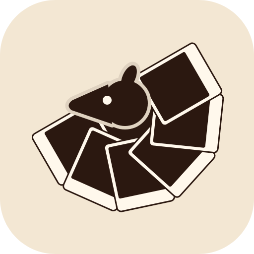

# PicDump — Brand Guidelines

**Version:** 3.1 (primary, secondary and accent roles; themes rebuilt from the brand palette, 30 October 2026; 3.0 added the logo; before that 2.0, the October 2026 redesign)
**Source of truth in code:** `src/theme/tokens.ts` (colours, shadows), `src/theme/type.ts` (fonts), `src/components/ui/` (shared pieces). If this file and the code disagree, the code wins; update this file.

---

## 1. Essence

PicDump turns a cluttered camera roll into ready-to-post photo dumps. It reads the whole library on the phone, groups photos into stories (trips, topics, Today), and lets you lay them out, filter them and hand them to Instagram or TikTok.

- **Private by design.** Indexing, stories, search and rendering run on the device. Photos are never uploaded to PicDump.
- **Scrapbook, not dashboard.** Photos look like printed photos: cream borders, a small tilt, tape on the hero. Paper-coloured cards, serif titles.
- **Free to start, Pro for the rest.** Free shows every dump's title and opens the recaps and one dump a week; Pro (weekly or yearly) opens everything (`PAYWALLS_ENABLED`, `src/constants/flags.ts`; rules in `docs/superpowers/specs/2026-10-28-monetization-design.md`). The app was called DayDump until October 2026; some identifiers still say `daydump` on purpose (README).

---

## 2. Logo

**The mark.** A small animal curled around a fan of photo prints: the "dump" being kept safe. Flat, two-tone, with a thin cream outline where the animal overlaps the prints. It sits on a rounded tile (corner radius 112 of 512).

**Files** (all in `design/brand/`):

| File | Use |
| :--- | :--- |
| `picdump-logo.svg` | The master: colourway 01 *espresso* on its parchment tile. Edit this, then run `npm run brand:assets`. |
| `png/picdump-logo-1024.png`, `-512.png` | Tile with transparent corners, for slides, docs, store graphics. |
| `png/picdump-logo-dark-1024.png` | Dark-surface colourway (09 *ristretto*). |
| `png/picdump-mark-transparent-1024.png` | The artwork alone, no tile, for placing on a colour of your own. |
| `colorways/01…24-*.svg`, `colorways/index.html` | The 24 colourways of the same mark, with their hex values (open `index.html`). |

**Colourways.** Each colourway is three colours: *tile* (background), *ink* (animal and print interiors) and *paper* (print borders), plus a knockout outline a shade off the tile. The primary is **01 espresso** (parchment tile `#F3E7D3`, ink `#2B1810`, paper `#FFF8EC`). **09 ristretto** (tile `#2A170F`, ink `#F2DFC0`, paper `#4A2D1E`) is the dark-surface version and is used for the dark splash and the dark alternate launcher icon. The other 22 are alternates (seasonal or alternate-icon candidates; what they are for is not stated in the files); none is used in the app yet.

**Where it ships** (generated by `scripts/brand/make-assets.cjs` from the SVGs):

| Output | Built from | Notes |
| :--- | :--- | :--- |
| `assets/icon.png` (iOS, legacy Android) | 01, tile filled to the corners | 1024 px, RGB with **no alpha** (App Store Connect rejects an alpha channel); the system rounds it. |
| `assets/android-icon-foreground.png` | 01 artwork only | Adaptive icon foreground; artwork kept inside the middle 66%. Background colour `#F3E7D3` in `app.json`. |
| `assets/splash-icon.png`, `splash-icon-dark.png` | 01 and 09 artwork | `expo-splash-screen` plugin: `#F3E7D3` light, `#2A170F` dark, image width 200. |
| `assets/icon-dark.png` | 09 artwork | Alternate "dark" launcher icon (debug switch in Profile). |
| `assets/favicon.png` | 01 tile | 48 px. |

**Clear space and size (proposed: the logo files carry no usage rules, so these are working defaults until the designer says otherwise).** Keep clear space around the tile of at least one print border (about 1/16 of the tile width). Do not draw the mark smaller than 24 px on screen; below that use the tile alone.

**Do not (same status):** recolour the artwork outside a published colourway, change the knockout outline, stretch or rotate the mark, put the espresso (dark-ink) artwork on a dark background (use ristretto), add shadows or effects, redraw the animal.

**Not done yet:** a themed (monochrome) Android icon, an iOS 18 dark or tinted icon, and the store graphics that use the logo (screenshots and the Play feature graphic, P8.2). The `cards` alternate launcher icon is still the old artwork.

---

## 3. Colour

### Roles

| Role | Colour | Hex | Used for |
| :--- | :--- | :--- | :--- |
| **Primary** | Espresso | `#2B1810` | Text and icons on light, primary buttons and active pills, the logo ink |
| **Secondary** | Parchment | `#F3E7D3` | The light screen background, the logo tile, the adaptive icon and light splash |
| Secondary, lighter | Paper | `#FFF8EC` | Cards, sheets, inputs on light; print borders |
| Secondary, quiet | Knockout | `#DFD2C0` | Tape, hairlines, quiet fills (the outline in the logo) |
| **Accent** | Caramel | `#E8A94F` | Accent buttons and highlights, with espresso text (8.2:1); as text or icon on the dark theme (7+:1) |
| Accent, deep | Rust | `#A84A2F` | Accent text on light surfaces (4.7:1 on parchment), fill with paper text (5.4:1), the Draft pill on dark |
| Dark surface | Ristretto | tile `#2A170F`, ink `#F2DFC0`, paper `#4A2D1E` | The dark theme, dark splash, dark alternate icon |

Espresso, parchment, paper, knockout and ristretto come from the logo (colourways 01 and 09). **The accent is not in the logo**: the logo is only espresso, parchment, paper and a knockout. Caramel is colourway 11's tile; rust is the colour the app already used as its dark accent. They are a proposal and live in one place (`brand.caramel`, `brand.rust` in `src/theme/tokens.ts`). Caramel is bright, so never use it as text on a light background (1.7:1); use rust there.

Espresso on parchment is 13.9:1, paper on espresso 16.0:1, ristretto ink on its tile 13.1:1. All of it is in `brand` in `src/theme/tokens.ts`, and the two UI themes below are built from it (`__tests__/theme-contrast.test.ts` fails if they drift).

### UI themes

Two themes. The app follows the system setting; Profile → Appearance overrides it (System / Cashmere / Espresso). Always read colours through `useTheme()`; never call `useColorScheme()` directly. Cashmere is parchment with paper cards and espresso ink; Espresso is the ristretto colourway.

| Token | Cashmere (light) | Espresso (dark) | Use |
| :--- | :--- | :--- | :--- |
| `bgScreen` | `#F3E7D3` parchment (+ gentle gradient `#F6ECDB → #F3E7D3 → #F1E2CB`) | `#2A170F` | Screen background |
| `bgCard` | `#FFF8EC` paper | `#3A2316` | Cards, sheets, inputs |
| `borderSubtle` | `rgba(43,24,16,0.08)` | `rgba(242,223,192,0.09)` | Card edges, dividers |
| `borderStrong` | `rgba(43,24,16,0.16)` | `rgba(242,223,192,0.17)` | Inactive chips, empty photo wells |
| `ink` | `#2B1810` espresso | `#F2DFC0` | Titles, primary text, active pills |
| `inkMuted` | `#6B5848` | `#B9A184` | Meta lines, section labels, hints (5.5:1 on parchment, 6.4 on paper; dark 6.9 and 5.9) |
| `accentFab` / `accentFabText` | `#E8A94F` caramel / `#2B1810` | `#E8A94F` / `#2B1810` | Accent buttons |
| `tapeBg` / `tapeBorder` | `rgba(223,210,192,0.72)` / `rgba(140,115,95,0.25)` | `rgba(232,169,79,0.34)` / `rgba(240,190,110,0.25)` | Masking tape on hero cards |
| `draftPill` | `rgba(43,24,16,0.06)` | `#A84A2F` | Library "Draft" pill |

The Today hub keeps its own rust accent (`accent(t)` in `SlotPop.tsx`: `#A84A2F` light, `#C25C3C` dark) because it is used both as text and as a fill under light text; in practice it is the deep accent.

Contrast: every text/background pair in both themes, and Cashmere over the parchment cards, is held to 4.5:1 by `__tests__/theme-contrast.test.ts`.

Theme-independent (`fixed`): print border `#FFF8EC` (paper), photo chips `rgba(0,0,0,0.6)` with `#F2DFC0` text, like red `#E0393E`, IG blue `#3897F0`.

Shadows are CSS `boxShadow` strings per theme: `shadowCard` (cards), `shadowDeck` (pinned bottom areas), `shadowPrint` (photo prints).

---

## 4. Type

Fonts are embedded by the expo-font plugin, one family per weight. Android ignores `fontWeight` for custom fonts, so choose the family and never set `fontWeight` with it.

| Role | Font | Helper |
| :--- | :--- | :--- |
| Page titles (28, line 1.05), hero (19.5), tile titles (15.5–16.5) | Source Serif 4 Medium, tracking −0.02em | `display(size, lineHeight?)` |
| Body, meta, buttons | Inter 400 / 500 / 600 / 700 | `ui(size, weight)` |
| Section labels ("OTHER DUMPS", "LAST SEARCHES") | Inter 600, uppercase, tracking 0.14em, `inkMuted` | `label(size)` |

Titles must fit: up to 2 lines with auto-shrink, never "…". Do not set `lineHeight` on text that auto-shrinks (Android does not scale it).

---

## 5. Shapes and components

- **FrameCard** — `bgCard`, 1px `borderSubtle`, `shadowCard`, radius 16. The basic container.
- **Print** — a photo with a cream `#FAF6F0` border, `shadowPrint`, small tilt. Stacks of prints (`PhotoStack`) show a dump; the Discover hero is taped (`Tape`) and tilted −1°.
- **Pill** — fully rounded; active = `ink` fill with `bgScreen` text, inactive = `borderStrong` outline.
- **Sheet** — bottom sheet in `bgCard` for menus and confirmations, instead of stock alerts where possible.
- **TabBar** — Discover · Create · Tidy · Library, custom icons from the mock.

---

## 6. Dumps: ratios, frames, layouts, filters

- **Ratios:** 4:5 (IG Post, default), 9:16, 1:1, 3:4. Default ratio and frame come from Profile.
- **Edit studio:** two tabs. *Layout* = ratio, arrangement tiles, the Frame card and crop (drag / pinch); a dashed *Grid crop* guide on slide 1 at 4:5 shows the 3:4 the profile grid keeps (Edit only). *Photos* = Look | Adjust | Texture; hold the slide to see the originals.
- **Frame (per dump, Layout):** Fit *Fill* (to the edge), *Matte* (inset border) or *Blur fill* (whole photo on a blurred copy, no crop); Gap 0–12 (default 3); Corners 0–16; matte colour Card (default #EFE6DA), Cream, White, Black, Kraft.
- **Layouts:** 1 Photo, 2 Split, 3 Bento, 2×2 Grid, Scrapbook. Photos are chunked across slides with no repeats.
- **Filters (Skia colour matrices, 0–100%):** Warm 35mm (default, 68%), Cashmere, Soft Film, Sunfade, B&W Roll, Original. Called *Look* in the studio: the dump's look by default ("All photos"); a photo tapped in the strip gets its own ("This photo", dot in the strip) until "Use on every photo" or "Reset photo". Look tiles show the photo itself. *Texture* (Grain, Fade, Vignette, 0–100) is part of the look. *Adjust* (Light, Contrast, Shadows, Warmth, Saturation on a ruler that clicks at 0; Sharpen 0–100) is always one photo's: the picked one, else the slide's first. *Auto* sets them from the photo's tone (tap again to undo); a dark photo offers *Brighten*.
- **Captions:** on-device templates, about 6 per dump.
- **Export:** 1080 px wide JPGs, saved to the "PicDump" album, then shared to Instagram or TikTok.

---

## 7. Voice

Short, plain, friendly. Say what happens: "Reading your library · 1,200 of 3,963", "Paused at 800 of 3,963", "Your current draft is safe in Library → Drafts". No hype words, no "AI magic". Meta lines read "{N} photos · {range}", for example "6 photos · Jun–Sep".

---

## 8. Haptics

- Selection change (dragging a filmstrip thumb, onboarding pages): `Haptics.selectionAsync()`.
- Primary taps: `Haptics.impactAsync(Light)`.
