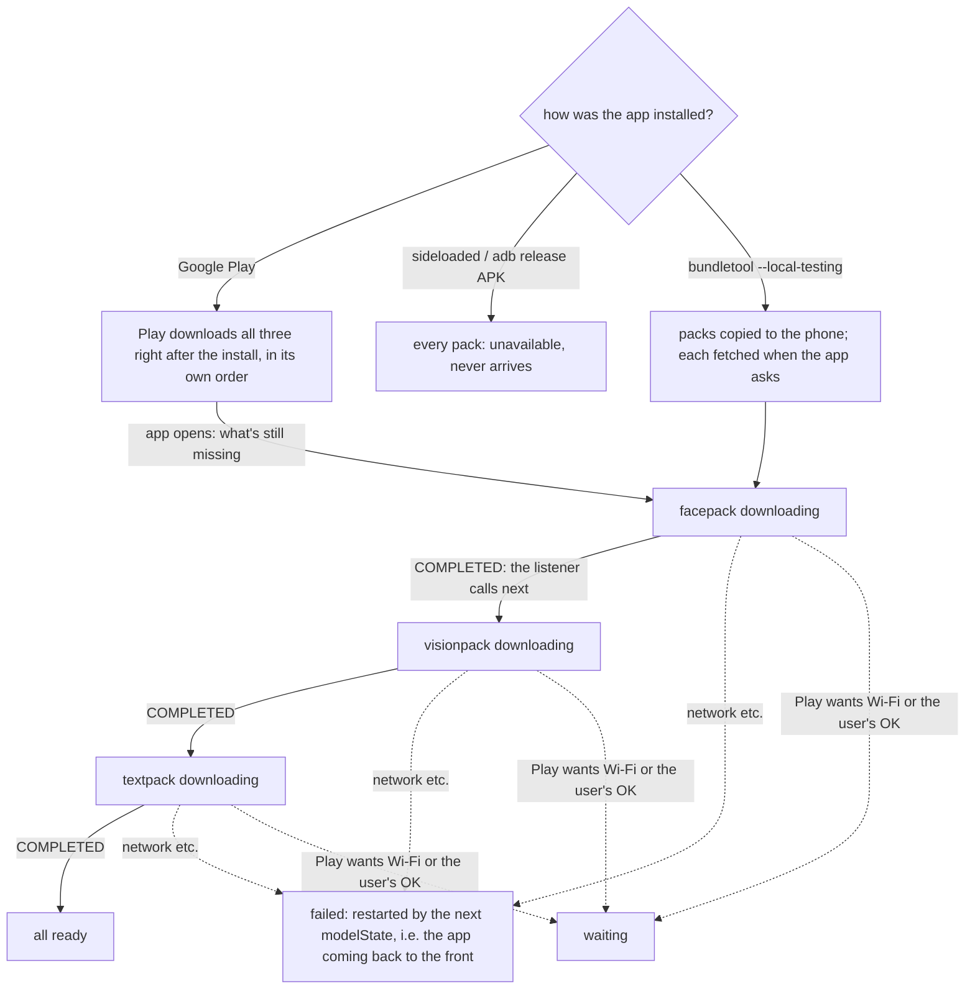
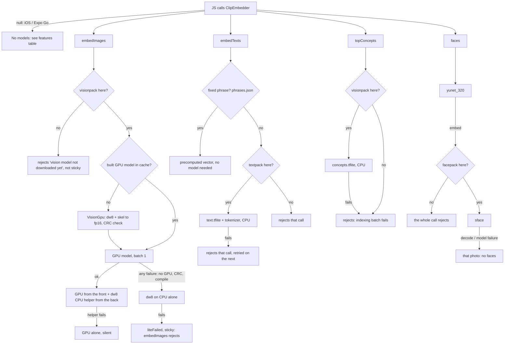

# Models: what ships, what loads, what happens without them

Keep this current. Update it in the same change whenever a model or asset is added, removed, moved out of the APK
(asset pack / download), gets a new fallback, or a feature starts or stops depending on one. Android only: the native
module (`modules/clip-embedder`) doesn't exist on iOS or in Expo Go, where `ClipEmbedder` is null.

Last checked against the code: 2026-10-28 (CLIP is our distilled model, tag distill-v2).

CLIP: image tower MobileNetV4-M (timm, Apache 2.0) distilled from PE-Core L/14-336 on Open Images; text tower TinyCLIP-45M's
(MIT) fine-tuned into its space (`DISTILLED` in `scripts/build_assets.py`, `research/distill/PLAN.md`). It replaced TinyCLIP-45M/32,
which used both of TinyCLIP's towers. Calibrated so cosines sit where 45M's did, so the app's fixed cutoffs hold (search floor 0.2,
same shot 0.92 / 0.95): photo vectors centered by 0.2 x their mean, and text vectors (and concept rows) are 1.33 long, not unit.
VIST val vs 45M: R@1 41.7 vs 42.1, tags 36.0 vs 36.1, R@5 68.4 vs 72.7. A new `clipGolden.json` model name makes every phone
re-read its library once (`photoIndex.db()`), keeping its dumps.

## Shipped assets

Base APK: `modules/clip-embedder/android/src/main/assets/clip/`. Packs: `modules/clip-embedder/android/<pack>/src/main/assets/clip/`.
Release builds download the packs from Play after the install (`ModelPacks.kt`); debug builds carry them in the APK.

| Asset | Where | On disk | Download | What it is | Loaded |
|---|---|---|---|---|---|
| `vision_dw8.tflite` | **visionpack** | 10.3 MB | 9.0 MB | CLIP image tower, int8 weights (depthwise convs fp32), CPU (XNNPACK) | first `embedImages` |
| `concepts.tflite` | **visionpack** | 3.7 MB | 1.9 MB | 3,566 precomputed concept-word vectors | first `topConcepts` |
| `sface.tflite` | **facepack** | 15.1 MB | 11.5 MB | face recognition (who is it), fp16 + int8 FCs | first `faces(…, embed=true)` |
| `text.tflite` | **textpack** | 32.5 MB | 27.4 MB | CLIP text tower, CPU: int8 matmuls, int4 token table (int8 everywhere was 45.1 MB, same accuracy on VIST test) | first `embedTexts` of a non-fixed phrase |
| `tokenizer.json` | **textpack** | 2.2 MB | 0.6 MB | text tokenizer | same |
| `vision_gpu.skel` | APK | 18.4 MB | 0.6 MB | GPU image model minus its int8 weights; `VisionGpu` fills them from dw8 into `cacheDir/litert/vision-<install>.tflite` (18 MB). Stays in the APK: a pack would unpack it to 18 MB | first `embedImages` |
| `phrases.json` | APK | 8 KB | ~0 | the selfie finder's 3 phrases, already embedded (`FIXED_PHRASES` in build_assets.py) | first `embedTexts` |
| `vocab.json` | APK | 0.05 MB | ~0 | the 3,566 concept names | `loadLibrary` (app start) |
| `yunet_320.tflite` | APK | 0.3 MB | 0.2 MB | face detection (where are faces) | first `faces` |
| `gate.tflite` | APK | 5.2 MB | 4.7 MB | MobileNetV3-Small (timm, Apache 2.0), fp16 weights: the selfie step's P(document, screen or pet) and near-copy feature until visionpack lands (int8 was tried: it lets 19/30 pets through) | first `selfieCheck` / `warmSelfie` without visionpack |
| ML Kit language ID + translation code | `translate` feature module, on demand (`modules/clip-embedder/android/translate`); debug builds compile it in | ~7.7 MB | ~7.7 MB | which language a search is in, and the translator (`MlKitTranslator.kt`, loaded by `TranslateFeature` in `QueryTranslateModule.kt`) | fetched with the first non-English search language; English phones never download it |
| ML Kit translation, one per search language | Google, on request (`com.google.mlkit:translate`) | ~30 MB each | ~30 MB each | translates a search to English on the phone (`index/queryLang.ts`). The phone's language is fetched at app start; Settings → Search languages adds or deletes others | first search that isn't confidently English |

Download (bundletool, arm64, measured 2026-10-28): **33.9 MB at install**, then visionpack 10.9 MB, facepack 11.5 MB, textpack 28.1 MB (84.4 MB in all), plus the 7.7 MB `translate` module on non-English phones (it was in the install before: 41.6 MB). Measured 2026-10-22 with TinyCLIP-45M: **33.0 MB at install** (48.3 MB before R8, lucide deep imports, dropping Compose and cutting Inter; models are 5.4 MB of it), then visionpack 42.8 MB, facepack 11.5 MB, textpack 41.0 MB (128.3 MB in all; was 98 MB at install with only the text pack split out, 138 MB before any). Built from `scripts/build_assets.py`. No other models in release
builds: sensitive-photo hiding uses the concept tags, and Gemini isn't called. Debug builds add EdgeBench (Gemma, ML Kit).

### Pack configs

Names for ways to split the models between the install and fast-follow (from the 2026-10-28 numbers above; only `split` is built today).
`gate.tflite` (4.7 MB) only stands in for CLIP until visionpack lands, so it goes once vision is in the install. Base has no
face-recognition model to drop with facepack in (`yunet_320` is detection, needed either way). Every config adds the `translate`
module (7.7 MB) and ML Kit translation (~30 MB per language) on request when a search language isn't English.

| Config | At install | Fast-follow | Total |
|---|---|---|---|
| `split` (now) | 33.9 MB | vision 10.9, face 11.5, text 28.1 MB | 84.4 MB |
| `vis` | ~40.1 MB (+ vision, − gate) | face 11.5, text 28.1 MB | ~79.7 MB |
| `vis-face` | ~51.6 MB | text 28.1 MB | ~79.7 MB |
| `all` | ~79.7 MB | none | ~79.7 MB |

## Download order (release builds)

All three are fast-follow: Play starts them at install, app opened or not, in an order Play picks (not documented;
check on an internal-app-sharing build). Whatever isn't on the phone yet when the app runs is fetched by the app, one at
a time, so each gets the whole connection: faces first (onboarding's selfie step comes first and needs it to tell the
owner from friends), then vision (Home's dumps and Create's grid wait on it), then textpack. A screen's want
(`useModels(want)` → `wantModel`) can't jump vision:

| # | Pack | Delivery | Unlocks |
|---|---|---|---|
| 1 | facepack | fast-follow. Wanted by onboarding's selfie step, /selfie, People (any `faces(embed)` call) | People; the selfie pick groups faces into people (works without it) |
| 2 | visionpack | fast-follow | indexing → Discover dumps, Create's photo grid, topics; sharper selfie filtering (the gate stands in) |
| 3 | textpack | fast-follow. Wanted by Create (first visit), still after visionpack | Create search by words |

`ModelPacks.next()` fetches the next missing pack (faces, then vision, then the last wanted, then Pack order) unless one is already
downloading. It runs when the module starts (app launch), when a pack completes, from `modelState()`, when a call needs a
missing pack (that also wants it), and from the background worker. Packs behind it report `queued`. A want doesn't stop
the pack already downloading (ponytail: Play may drop a cancelled pack's bytes; cancel it if waiting behind it hurts).

JS sees it through `modelState()` → `{vision, faces, text}: {state, progress}` (`ready | downloading | queued | waiting |
failed | unavailable`) and the `onModels` event (`{pack, state, progress}`). `src/state/models.ts` keeps one copy for
the app: `useModels()` for screens, `whenReady(pack)` for code, refreshed when the app comes back to the front.

## Loading and fallbacks

In every "not here" case the model's `by lazy` throws and loads on the next call once the pack has landed.

Caches live in `cacheDir/litert`, keyed by install time: XNNPACK `dw8-`, `text-`, `concepts-`; the GPU program cache;
the built `vision-` model. `ClipEngine`'s init deletes entries from older installs. Indexing (GPU and CPU) sleeps while
the user touches the screen (`holdIndexing`).

## Features and the models they need

| Feature | Needs | While its pack is downloading | Other failures |
|---|---|---|---|
| Indexing (Discover strip, Profile "Index") | visionpack | `refreshStories` waits (`whenReady('vision')`); existing dumps stay | Module missing: rows are stored with no vectors. Model failure: the refresh stops silently (console warning only) |
| Background indexing (WorkManager) | visionpack | worker returns `retry` and kicks the download | worker throws; status reads idle |
| Discover | visionpack (via indexing) | no dumps yet: the **download card** (`ModelLoading`: developing prints, %, bar) instead of "No dumps yet" | |
| Discover's Today card (Dump Meter, `services/today.ts`; dev tools → Today tags) | visionpack (today's indexed camera photos' vectors; same shot at cosine 0.92); textpack (one phrase per slot: food, sky, close-up, wide, night, mirror, and you / friends without a face match); yunet + facepack/SFace (You = a face matching the profile avatar, Friends = any other face). Night also by the hour taken (21:00-05:00) | not indexed yet: today's photos aren't counted, the card waits for them | No textpack: only Night (by hour) and face slots fill. No facepack or no avatar: You / Friends fall back to their phrases. No photos today: no card |
| Create photo grid | visionpack (via indexing) | empty library: the same download card | |
| Create search: free words | textpack + stored vectors | a search with words and no hits: the **"Word search is on its way"** card, % and bar; re-searches when it lands | "No matches", retried on the next search |
| Create search: places, months | none | always work | |
| Create search in other languages | textpack; the `translate` module; ML Kit translation for that language | searches as typed, with "Turkish is still downloading (about 30 MB)…" under the search; Settings → Search languages shows Downloading / Ready | download failed: "didn't download… Retry in Settings" (tap the row to retry); translation fails: searches as typed. iOS / no module: English only, section hidden |
| Create search: emoji | textpack | as free words | emoji are searched as their names (`emojiNames.json`, from Unicode's emoji-test.txt) next to the emoji |
| Stories: Trips, Today | none (GPS, dates) | indexing waits, so none until visionpack lands | |
| Stories: topics, curation, Hide sensitive photos | stored concept tags | as indexing | Module missing: no topics, **Hide sensitive photos does nothing** |
| Similar / Suggest fills / Edit swaps | stored vectors only | as indexing | "Nothing similar to suggest yet"; swaps fall back to nearest in time |
| Selfie finder (`useSelfiePick`: onboarding's profile step, scanning from the photo grant; /selfie) | yunet; visionpack if there, else gate; facepack if there (groups faces into people: the owner is in the most selfies). Doesn't wait for the photo index | `SelfieFinder` doesn't wait for any download: "Picking your best selfie" (bar) while it goes through the camera photos, 30 at a time, starting on the library's first page of 1000 while the rest is listed: sizes other than the main camera's first (the front camera's), each newest first; YuNet on MediaStore's cached 320 px thumbnails (`soloPhotos`, indexing held meanwhile), then only the photos with one big face decoded once more (`checkSelfies` → `selfieCheck`): YuNet and SFace on it while CLIP reads a 224 px copy on a CPU vision_dw8 of its own (never queued behind indexing). The next 30's thumbnails run during that check. Shows solo selfies only (one face ≥ 0.6 and ≥ 10% of the photo, no other face ≥ 0.35); photos tagged as documents (passport, ID, screenshot…) or other people (group, family, hug…) in their top 5 concepts, any cat or dog concept in their top 20, and near-copies (CLIP cosine > 0.92) are dropped. Before visionpack lands, `selfieCheck` runs the bundled gate on the same decode instead of CLIP: P(document, screen or pet) > 0.14 drops the photo (Commons test set: 20/20 IDs, 30/30 pets, about half of posters and video stills caught, 25/28 selfies kept); near-copies by its 1024-d feature (cosine > 0.90), sharpness by the face's Laplacian variance; no poor-avatar check, and photos picked then aren't rechecked once CLIP is there. Within a person, by `profileFit`: the avatar crop (a square ~2x the face) has its full margin and the face in its middle (a too-close or cut-off face loses), the face is >= 240 px tall, times CLIP's sharp-vs-blurry score (fixed phrase vectors, no textpack), halved for a poor-avatar concept in the top 5 (middle finger, crying, eating…). Without facepack: no grouping, best fit wins. Onboarding's strip: the picked person's other selfies (`mine`). Its YuNet and CLIP load during the onboarding slides (`warmSelfie`; without visionpack the gate loads at the scan's start), and the index's GPU model build waits out the hold. The first pick shows once those odd-sized photos are scanned (at most 240; listing done); scanning goes on in the background until 40 are found, so "Not me" (skips that face, SFace match) and "Try another" show the next one at once; none yet: "Looking further back"; none at all: "No other selfie on your phone" (onboarding: "No selfie found", Continue). Onboarding's "That's me" saves the face's square (512 px, `faceFile`) as the profile avatar; "Skip for now" leaves any time. Avatar sheet and Model bench still use `findSelfies` (CLIP's top 30 in the index) | yunet fails (or no native module, or iOS): no face found, so "No other selfie on your phone"; visionpack missing: the gate filters; gate fails too: nothing dropped beyond YuNet's one-face rule; facepack fails: biggest single face wins |
| Tidy tab (`services/tidy`) | visionpack (vectors and concept tags for photos the index skipped, embedded in the foreground); yunet (faces in same-shot sets: cut off, looking away, in shadow); facepack/SFace ("You’re in it": faces matched to the profile avatar, which locks the photo and favours that take); fixed sharp/blurry phrase vectors; textpack for the whiteboard / printed page / meme phrases (Paper and Saved from chats). Pixel checks (brightness, Laplacian, finger, horizon tilt) and exact-copy hashes need no model. Android 11+ only (MediaStore Trash) | no vectors: no Same shot sets, no Private / Paper / Chats piles; Exact copies (hash), Screenshots (folder) and Black frames still work | Module missing or Android < 11: "Needs Android 11 or newer". YuNet fails: Shot check has no face lines. No facepack or no avatar: nothing is "You’re in it". No textpack: Paper and Chats fall back to concept tags only. Eyes and smile are never checked (no face-expression model) |
| People experiment (dev tools) | yunet, facepack | Scan rejects | finds nobody |
| 8 PM daily recap | none | always works | text-only notification without the module |

## Onboarding

Slides (intro, privacy) → "Allow photos & continue" → access granted: indexing starts (`app.start`) and the profile step
(`ProfileStep`) shows: a post header as on dump previews, with "only on your previews, stays on your phone" up front. The
name is asked first and flies into the header (the selfie scan, `useSelfiePick`, runs from the grant meanwhile); then the
pick: "That's me" flies the face into the header's avatar and shows a strip of the same person's other selfies to swap it;
"Not me" moves to the next person. Continue saves the avatar; "Skip for now" leaves the initial letter. Continue needs a
pick unless none was found; indexing carries on either way.
Denied: straight to the app. The slides are two taps. The notification permission is asked after onboarding, not before it.

## What the user sees, by scenario

| Scenario | How it happens | What changes in the UI |
|---|---|---|
| Play install, first open within a minute | packs still downloading | Discover and Create: **"Getting your dumps ready"**, "Downloading 11 MB, once (N%)…". Onboarding's selfie step doesn't wait: the gate stands in for CLIP. Dumps start as soon as it lands |
| Play install, opened later | Play fetched the packs meanwhile | indexing starts at once; whatever is missing downloads in the background, faces first |
| Word search before textpack | behind facepack and visionpack | Create: **"Word search is on its way"**, "Downloading 28 MB, once (N%). Places and months work now." or "Next in line after the other downloads." |
| A pack waiting | Play holds it (Wi-Fi only, needs the user's OK) | that pack's card: "Waiting for Wi-Fi to download N MB, once." with **Download now with mobile data**, which opens Play's own dialog (`ModelPacks.askToDownload`: showCellularDataConfirmation, or showConfirmationDialog) |
| A pack failed | network error | "The N MB download stopped. Check your connection, then try again." with **Try again** (`retryModels`); also restarted on the next foreground |
| No packs at all | release APK sideloaded or installed with adb | every card: "This copy of DayDump can't download it. Install it from Google Play." plus "(Play error N)" when Play gave a reason. Discover never fills |
| Debug build | Metro / `expo run:android` | every pack is in the APK: always ready |
| Vision model fails (no GPU, no CPU) | very old / broken device | Indexing stops silently (console warning); no new topics, search hits |
| Face models fail | broken asset | yunet: selfie finder finds none ("No other selfie on your phone"), People finds nobody. facepack: selfie finder picks the biggest single face, People finds nobody |
| No native module | iOS, Expo Go | No CLIP anything, no download cards: Trips, Today, places and months only |

The UI has two availability signals: `Library.hasClip` (native module present) and `useModels()` (the packs). Nothing
tells the UI that a model on the phone failed to load.
