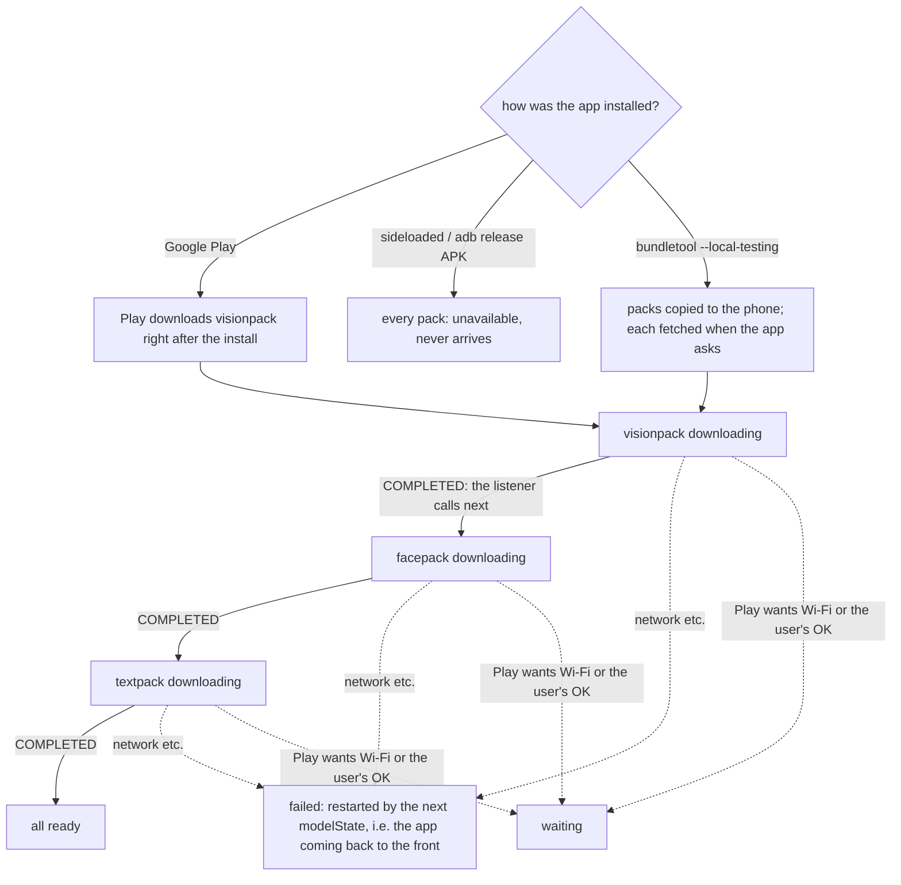
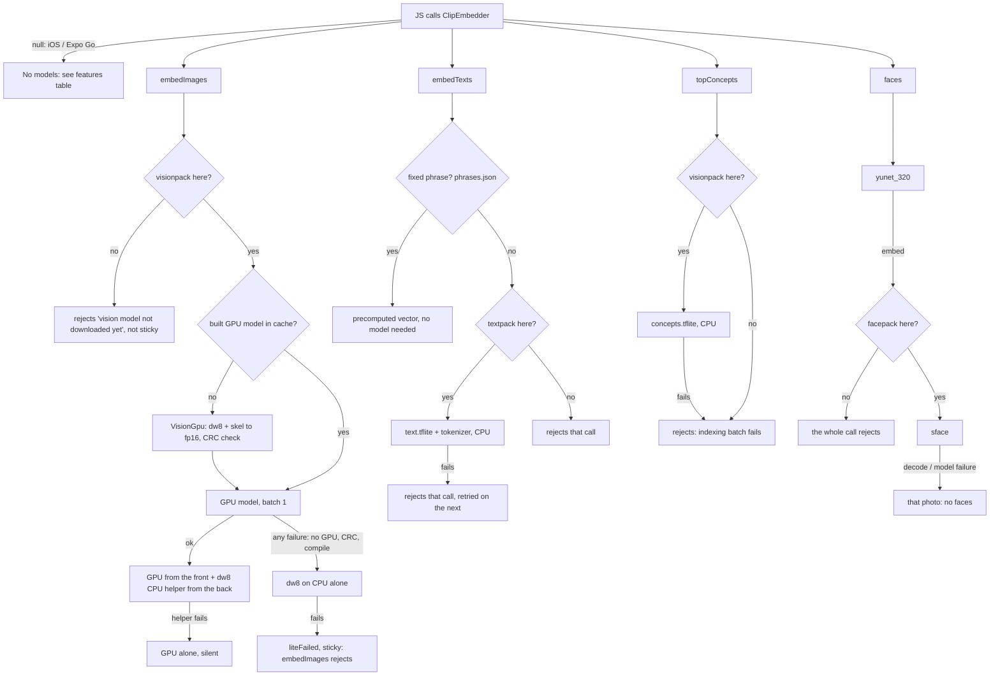

# Models: what ships, what loads, what happens without them

Keep this current. Update it in the same change whenever a model or asset is added, removed, moved out of the APK
(asset pack / download), gets a new fallback, or a feature starts or stops depending on one. Android only: the native
module (`modules/clip-embedder`) doesn't exist on iOS or in Expo Go, where `ClipEmbedder` is null.

Last checked against the code: 2026-10-21 (models split into three download packs, on top of 599f2db).

## Shipped assets

Base APK: `modules/clip-embedder/android/src/main/assets/clip/`. Packs: `modules/clip-embedder/android/<pack>/src/main/assets/clip/`.
Release builds download the packs from Play after the install (`ModelPacks.kt`); debug builds carry them in the APK.

| Asset | Where | On disk | Download | What it is | Loaded |
|---|---|---|---|---|---|
| `vision_dw8.tflite` | **visionpack** | 46.1 MB | 40.6 MB | CLIP image tower, int8 weights, CPU (XNNPACK) | first `embedImages` |
| `concepts.tflite` | **visionpack** | 3.7 MB | 2.2 MB | 3,566 precomputed concept-word vectors | first `topConcepts` |
| `sface.tflite` | **facepack** | 15.1 MB | 11.5 MB | face recognition (who is it), fp16 + int8 FCs | first `faces(…, embed=true)` |
| `text.tflite` | **textpack** | 45.0 MB | 40.4 MB | CLIP text tower, CPU | first `embedTexts` of a non-fixed phrase |
| `tokenizer.json` | **textpack** | 2.2 MB | 0.6 MB | text tokenizer | same |
| `vision_gpu.skel` | APK | 90.4 MB | 0.4 MB | GPU image model minus its weights; `VisionGpu` fills them from dw8 into `cacheDir/litert/vision-<install>.tflite` (90 MB, ~1 s on the A54). Stays in the APK: a pack would unpack it to 90 MB | first `embedImages` |
| `phrases.json` | APK | 8 KB | ~0 | the selfie finder's 3 phrases, already embedded (`FIXED_PHRASES` in build_assets.py) | first `embedTexts` |
| `vocab.json` | APK | 0.05 MB | ~0 | the 3,566 concept names | `loadLibrary` (app start) |
| `yunet_320.tflite` | APK | 0.3 MB | 0.2 MB | face detection (where are faces) | first `faces` |

Download (bundletool, arm64, 2026-10-21): **43.3 MB at install**, then visionpack 42.8 MB, facepack 11.5 MB, textpack 41.0 MB (138.6 MB in all; was 98 MB at install with only the text pack split out, 138 MB before any). Built from `scripts/build_assets.py`. No other models in release
builds: sensitive-photo hiding uses the concept tags, and Gemini isn't called. Debug builds add EdgeBench (Gemma, ML Kit).

## Download order (release builds)

One pack at a time, so each gets the whole connection, in the order the app needs them:

| # | Pack | Delivery | Unlocks |
|---|---|---|---|
| 1 | visionpack | fast-follow: Play starts it at install, app opened or not | indexing → Discover dumps, Create's photo grid, topics, captions |
| 2 | facepack | on-demand: the app fetches it when visionpack lands | People; sharper selfie pick (works without it) |
| 3 | textpack | on-demand: fetched when facepack lands | Create search by words |

`ModelPacks.next()` fetches the first pack in the order that isn't on the phone. It runs when the module starts (app
launch), when a pack completes, from `modelState()`, when a call needs a missing pack, and from the background worker.
Packs behind it report `queued`. ponytail: a feature waiting on a later pack doesn't jump the queue.

JS sees it through `modelState()` → `{vision, faces, text}: {state, progress}` (`ready | downloading | queued | waiting |
failed | unavailable`) and the `onModels` event (`{pack, state, progress}`). `src/state/models.ts` keeps one copy for
the app: `useModels()` for screens, `whenReady(pack)` for code, refreshed when the app comes back to the front.

## Loading and fallbacks

In every "not here" case the model's `by lazy` throws and loads on the next call once the pack has landed.

Caches live in `cacheDir/litert`, keyed by install time: XNNPACK `dw8-`, `text-`, `concepts-`; the GPU program cache;
the built `vision-` model. `ClipEngine`'s init deletes entries from older installs. Indexing (GPU and CPU) sleeps while
the user touches the screen (`holdIndexing`).

## Features and the models they need

| Feature | Needs | While its pack is downloading | Other failures |
|---|---|---|---|
| Indexing (Discover strip, Profile "Index") | visionpack | `refreshStories` waits (`whenReady('vision')`); existing dumps stay | Module missing: rows are stored with no vectors. Model failure: the refresh stops silently (console warning only) |
| Background indexing (WorkManager) | visionpack | worker returns `retry` and kicks the download | worker throws; status reads idle |
| Discover | visionpack (via indexing) | no dumps yet: the **download card** (`ModelLoading`: developing prints, %, bar) instead of "No dumps yet" | |
| Create photo grid | visionpack (via indexing) | empty library: the same download card | |
| Create search: free words | textpack + stored vectors | a search with words and no hits: the **"Word search is on its way"** card, % and bar; re-searches when it lands | "No matches", retried on the next search |
| Create search: places, months | none | always work | |
| Stories: Trips, Today | none (GPS, dates) | indexing waits, so none until visionpack lands | |
| Stories: topics, curation, Hide sensitive photos, captions | stored concept tags | as indexing | Module missing: no topics, **Hide sensitive photos does nothing** |
| Similar / Suggest fills / Edit swaps | stored vectors only | as indexing | "Nothing similar to suggest yet"; swaps fall back to nearest in time |
| Selfie finder (onboarding's last step, /selfie) | visionpack, phrases.json, yunet + the first 200 indexed photos; facepack if there (groups faces into people: the owner is in the most selfies) | `SelfieFinder` shows what it waits for: visionpack's download, then "Reading your recent photos" (bar), then "Picking your best selfie" (indexing held meanwhile). Shows solo selfies only (one face ≥ 0.6 and ≥ 10% of the photo, no other face ≥ 0.35); photos tagged as documents (passport, ID, screenshot…), pets or other people (group, family, hug…) and near-copies (CLIP cosine > 0.92) are dropped first. Without facepack: the biggest single face wins. The first pick waits for a second one behind it (up to 600 photos read). "Not me" skips that face (SFace match) and shows the next one at once: the next 30 are checked in the background while one is up, again every 150 photos read while fewer than 2 wait; none yet: "Looking further back" while indexing goes on; none at all: "No other selfie on your phone". "Go to my dumps" leaves any time | no candidates: "No selfie found yet" |
| People experiment (dev tools) | yunet, facepack | Scan rejects | finds nobody |
| 8 PM daily recap | none | always works | text-only notification without the module |

## Onboarding

Slides → "Allow photos & start" → access granted: indexing starts (`app.start`) and the selfie step follows while it
reads; denied or skipped: straight to the app. The selfie step never blocks: its button ("Go to my dumps") works from
the first second, and indexing carries on. No Skip: the slides are three taps. The notification permission is asked after onboarding, not before it.

## What the user sees, by scenario

| Scenario | How it happens | What changes in the UI |
|---|---|---|
| Play install, first open within a minute | visionpack (42.8 MB) still downloading | Discover and Create: **"Getting your dumps ready"**, "Downloading (N%)…". Onboarding's selfie step: the same. Dumps start as soon as it lands |
| Play install, opened later | Play fetched visionpack meanwhile | indexing starts at once; faces then text download in the background |
| Word search before textpack | last in the order | Create: **"Word search is on its way"**, "Downloading (N%). Places and months work now." or "Next in line after the other downloads." |
| A pack waiting | Play holds it (Wi-Fi, needs the user's OK) | that pack's card: "Waiting for Wi-Fi." |
| A pack failed | network error | "The download stopped. DayDump tries again when you come back." Restarted on the next foreground |
| No packs at all | release APK sideloaded or installed with adb | every card: "This copy of DayDump can't download it. Install it from Google Play." Discover never fills |
| Debug build | Metro / `expo run:android` | every pack is in the APK: always ready |
| Vision model fails (no GPU, no CPU) | very old / broken device | Indexing stops silently (console warning); no new topics, captions, search hits |
| Face models fail | broken asset | Selfie finder falls back to CLIP order; People finds nobody |
| No native module | iOS, Expo Go | No CLIP anything, no download cards: Trips, Today, places and months only |

The UI has two availability signals: `Library.hasClip` (native module present) and `useModels()` (the packs). Nothing
tells the UI that a model on the phone failed to load.
