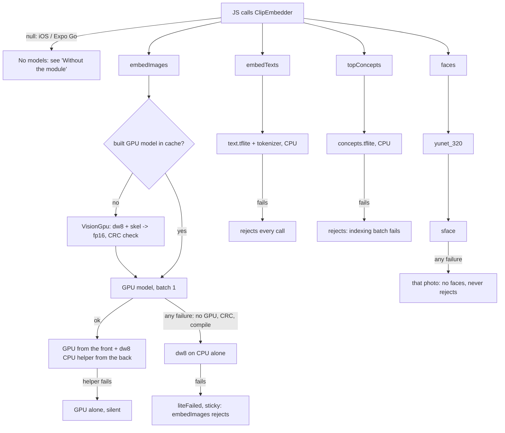

# Models: what ships, what loads, what happens without them

Keep this current. Update it in the same change whenever a model or asset is added, removed, moved out of the APK
(asset pack / download), gets a new fallback, or a feature starts or stops depending on one. Android only: the native
module (`modules/clip-embedder`) doesn't exist on iOS or in Expo Go, where `ClipEmbedder` is null.

Last checked against the code: 2026-10-21 (commit 1cf2d19).

## Shipped assets (`modules/clip-embedder/android/src/main/assets/clip/`)

| Asset | On disk | Download | What it is | Loaded |
|---|---|---|---|---|
| `vision_dw8.tflite` | 46.1 MB | 40.6 MB | CLIP image tower, int8 weights, CPU (XNNPACK) | first `embedImages` |
| `vision_gpu.skel` | 90.4 MB | 0.4 MB | GPU image model minus its weights; `VisionGpu` fills them from dw8 into `cacheDir/litert/vision-<install>.tflite` (90 MB, ~1 s on the A54) | first `embedImages` |
| `text.tflite` | 45.0 MB | 40.4 MB | CLIP text tower, CPU | first `embedTexts` |
| `tokenizer.json` | 2.2 MB | 0.6 MB | text tokenizer | first `embedTexts` |
| `concepts.tflite` | 3.7 MB | 2.2 MB | 3,566 precomputed concept-word vectors | first `topConcepts` |
| `vocab.json` | 0.05 MB | ~0 | the 3,566 concept names | `loadLibrary` (app start) |
| `sface.tflite` | 15.1 MB | 11.5 MB | face recognition (who is it), fp16 + int8 FCs | first `faces(…, embed=true)` |
| `yunet_320.tflite` | 0.3 MB | 0.2 MB | face detection (where are faces) | first `faces` |

Whole app download: 138 MB (bundletool, 2026-10-21). Built from `scripts/build_assets.py`. No other models in release
builds: sensitive-photo hiding uses the concept tags, and Gemini isn't called. Debug builds add EdgeBench (Gemma, ML Kit).

## Loading and fallbacks

Caches live in `cacheDir/litert`, keyed by install time: XNNPACK `dw8-`, `text-`, `concepts-`; the GPU program cache;
the built `vision-` model. `ClipEngine`'s init deletes entries from older installs. Indexing (GPU and CPU) sleeps while
the user touches the screen (`holdIndexing`).

## Features and the models they need

| Feature | Needs | Without them |
|---|---|---|
| Indexing (Discover strip, Profile "Index") | vision, concepts | Module missing: rows are stored with no vectors, progress still shows. Model failure: the refresh stops silently (console warning only), existing stories stay, and every later run fails the same way. |
| Background indexing (WorkManager) | vision, concepts | Worker throws; status reads idle. |
| Stories: Trips, Today | none (GPS, dates) | always work |
| Stories: topics, curation, Hide sensitive photos | stored concept tags (from indexing) | Module missing: no topics, and **Hide sensitive photos does nothing**. |
| Captions, hashtags, topic titles | stored concept tags | no labels |
| Create search: free words | text, tokenizer + stored vectors | "No matches". A failed text call is cached as null for the session (`create.tsx:36`). |
| Create search: places, months | none | always work |
| Similar / Suggest fills / Edit swaps | stored vectors only | "Nothing similar to suggest yet"; swaps fall back to nearest in time |
| Selfie finder (Profile avatar sheet, /selfie) | text (3 fixed phrases), yunet, sface + stored vectors | "No selfie found on your phone yet." |
| People experiment (dev tools) | yunet, sface | button does nothing |
| 8 PM daily recap | none | text-only notification without the module |

The only availability flag the UI has is `Library.hasClip` (module present). Nothing tells the UI that a model failed
to load or hasn't arrived yet.
